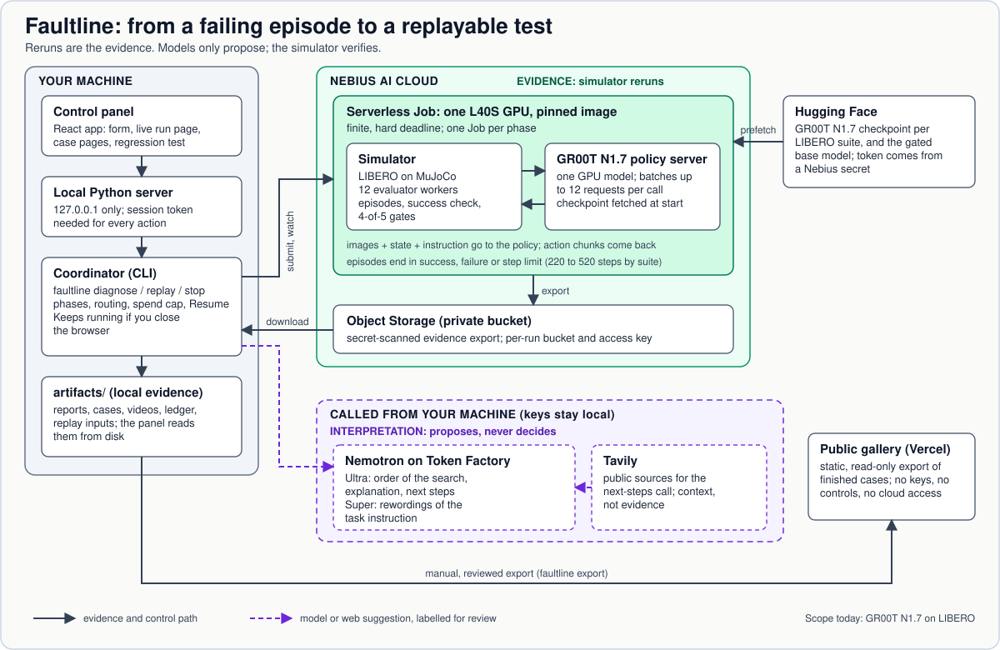
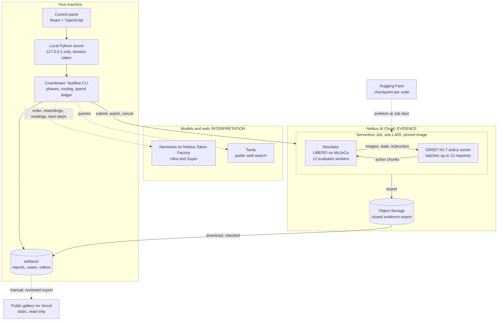
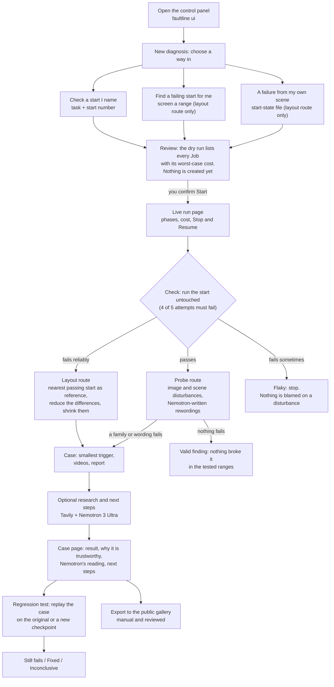
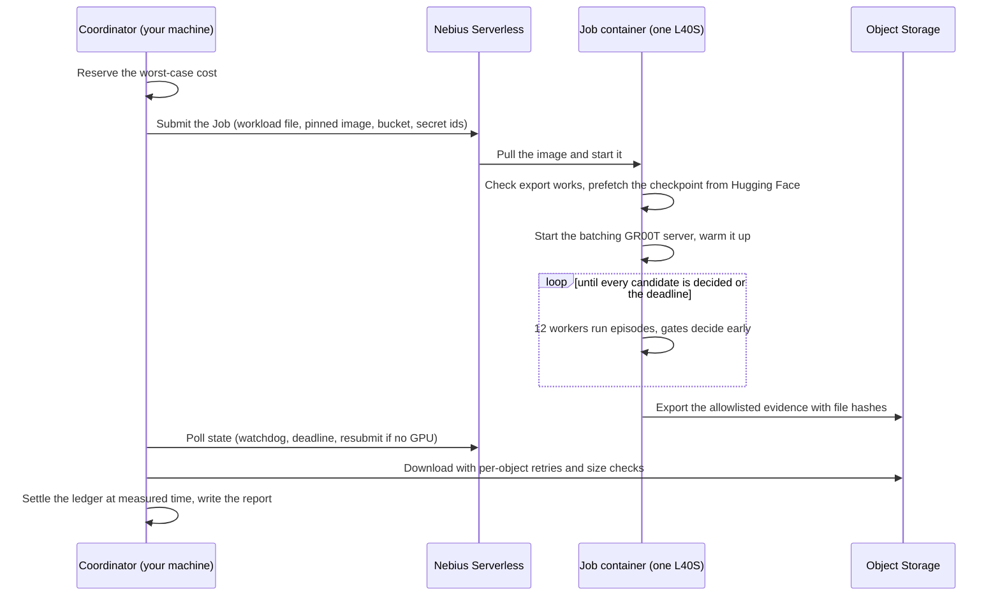

# Faultline architecture

How Faultline works, in the order you would walk someone through it. For what
every report column, severity and stop reason means, see the
[Reference](reference.md). For click-by-click use, see the
[UI runbook](ui-runbook.md). For setup, see the [quickstart](setup/diagnose.md).

## 1. What it does

Faultline helps a team that trains a robot policy. A success rate says how
often the policy fails, not under which conditions. Faultline finds the
**smallest condition that makes the policy fail**, **confirms by rerunning
that the failure repeats**, and keeps it as a **replayable regression test**
to rerun on every new checkpoint. It works on simulated manipulation policies
(vision-language-action models).

**Scope today:** NVIDIA GR00T N1.7 on the LIBERO benchmark (four suites, 40
tasks, one simulated arm). The loop is not tied to LIBERO, but another
simulator needs an adapter that is not built
([Where it applies](reference.md#where-it-applies)).

Words used below: a **start** is one fixed starting layout of a task (LIBERO
ships 50 per task). An **episode** is one attempt by the policy from a start. A
**Job** is one finite GPU container run on Nebius. A **case** is a saved finding
with its report, videos and replay inputs.

## 2. System diagram

The same picture as editable text. Solid lines carry evidence and control.
Dotted lines carry suggestions from models and the web, which are labelled for
review and never decide an outcome.

Three trust zones:

| Zone | What it holds | How far to trust it |
| --- | --- | --- |
| **Evidence** (Nebius Jobs) | Simulator reruns of the policy, success checks, exported files, spend ledger | This is the result. Every claim in a case comes from reruns. |
| **Interpretation** (Nemotron, Tavily) | Search order, rewordings, readings, next steps, public sources | Proposals and context. A bad answer wastes time, never changes a verdict. |
| **Public** (Vercel gallery) | Selected finished cases | Read-only. No keys, no controls, no way to start a run. |

## 3. The user flow

One **New diagnosis** does everything. The start is first run untouched, then
the result picks the route.

What the user sees at each step:
- **Choose and review.** Name a start (usually an episode that failed in a LIBERO
  evaluation), or screen a range, or bring a start file. The form writes the same
  YAML spec as the CLI. The dry run prints each Job's worst-case cost; Start is an
  explicit click.
- **Watch.** The run page polls recorded progress. Stop cancels the current Job.
  Closing the browser does not stop the detached run.
- **Read the case.** Result and videos first, then why to trust it (gate counts,
  each shift alone passing, the control), then Nemotron's reading and next steps,
  then the full evidence.
- **Navigate by case, not engine.** The sidebar and static gallery use one
  Cases list, with names, fault codes and outcomes rather than type groups or
  badges. Tested conditions and methods remain in each case. The global All
  evidence page was removed after walkthrough review; per-case evidence and
  the underlying records/API remain available.
- **Keep it.** The regression test replays the case in a fresh Job. Export
  publishes finished cases to the static gallery.

Suggested demo order: open the finished case `FL-S-8E0D` (it works offline from
`demo/root`), then its trust section and Regression test, the Reference, and the
public gallery.

## 4. What happens inside one Job

Each phase of a diagnosis is one Job: the check, a layout reduction, each group
of probes, a rewording screen. The coordinator reserves the Job's worst-case
cost first, then submits it.

- **Image.** Pinned by digest, built on the AllenAI vla-evaluation-harness LIBERO
  image. Weights are fetched at start, not baked in. The Hugging Face token
  reaches the Job as a Nebius secret, never in the spec.
- **One GPU, 12 workers.** The policy server batches up to 12 concurrent requests,
  so 12 simulator processes share one model. Batching gave +18% throughput at 12
  workers and nothing at 8 ([M3](experiments/m3-batched-inference.md)).
- **Episodes** end in success, failure, or the suite's step limit (220 Spatial, 280
  Object, 300 Goal, 520 LIBERO-10). Running out of steps counts as a failure.
- **Early-decided gates.** A scene reproduces a failure at 4 of 5 attempts and
  passes at 5 of 5. A gate stops once its answer is fixed and skips the rest
  ([gate](reference.md#3-the-repeatability-gate)).
- **Recovery.** With no free GPU the Job is resubmitted (up to six submissions). A
  failed download keeps the paid Job re-attachable, and Resume downloads again
  without rerunning it. That recovered two interrupted downloads in the showcase
  ([record](experiments/m7-final-showcase.md)).

## 5. The diagnosis engines

Each engine is a Job workload the coordinator picks by route. Formulas and
worked examples are in the [Reference](reference.md).

### The check

The start runs untouched under the repeatability gate. The same Job screens a
pool of nearby starts (by default 0 to 19) that supplies passing references. The
result picks the route: fails reliably, passes, or fails sometimes (flaky).

### Layout reduction (the start fails)

Question: which differences from a nearby passing start does the failure need?

1. Pick the nearest passing start as the **reference** (5 of 5 pass) and list
   what differs: object positions and rotations, the arm's joints.
2. Gates: the failing start reproduces, the reference passes, and the **full
   hybrid** (every difference applied to the reference) reproduces.
3. Try each entity alone, then **delta debugging** (`ddmin`): test smaller
   groups until removing any one entity makes the failure go away.
4. **Shrink** each surviving part by four bisection steps toward the reference.
   If a Job hits its candidate budget, up to three continuation Jobs resume
   from the smallest set that reproduced.

Example `FL-S-8E0D` (LIBERO-10 task 0, start 14, reference start 4): five
differences, of which **four shifts are needed together** (basket 2.1 cm, milk
2.2 cm, orange juice 0.8 cm, the arm's joints up to 2.1 degrees). Each alone
passes. Details: [layout route](reference.md#4-the-layout-route-how-a-scenario-reduction-works).

### Disturbance probes (the start passes)

Question: what is the smallest disturbance that breaks it?

1. **Control:** the start, undisturbed, must pass 5 of 5 or nothing is judged.
2. **Sweep** severity 0.2, 0.4, 0.6, 0.8, 1.0, five attempts per level.
3. **Bisect** four steps between the last passing level and the first failing
   one. The result is the smallest tested level that reproduces.

Ten families, one at a time: eight image families (blur, noise, darken,
contrast, JPEG, colour cast, motion blur, dead pixels) and two scene families
(camera viewpoint, lighting). The defaults are blur, noise, darken and contrast.
Example `FL-A-D582`: blur breaks LIBERO-Object task 0, start 0 from severity
0.4625 (a sigma of 3.7 px). Details: [probes](reference.md#5-the-probes-route-disturbances-and-rewordings).

### Rewordings (the start passes)

Question: can different words for the same task break the policy?
Nemotron 3 Super writes alternatives, and a **meaning check** drops any that
lose an object or target word. The original wording is the control and each
rewording gets one screening attempt. A failing one is confirmed at 4 of 5, then
reduced by removing word edits while it still fails.

### Regression test (replay)

A replay reruns a saved case in a fresh Job, five attempts each, with its
control: the minimal scene and reference (layout), each failing family at its
threshold (probe), or the failing wording (rewording). The checkpoint is the
original, or a new one given as a Hugging Face id plus a pinned revision. The
verdict is **Still fails**, **Fixed** (new checkpoint), **Did not repeat** (same
checkpoint, so possibly flaky) or **Inconclusive**. `faultline replay CASE
--expect fixed` turns it into an exit code for CI
([details](reference.md#the-regression-test)). In the showcase, replays of
`FL-S-8E0D` and `FL-A-D582` on the same checkpoint both still failed.

## 6. Where Nemotron and Tavily sit

The model proposes, the simulator verifies. A model call can reorder work or add
labelled text, and a bad answer is rejected or ignored. None decides whether an
episode succeeded.

| Call | Model | Input | Output | How it is checked |
| --- | --- | --- | --- | --- |
| Hypothesis (layout, before reruns) | Nemotron 3 Ultra, else Super | Task instruction and the difference table only | A ranking of entities and a one-line guess | Strict JSON, unknown entity rejected. Any problem falls back to a fixed order. It sets only the test order. Reruns later label each top entity needed or not, enough alone or not |
| Explanation (layout cases) | Nemotron 3 Ultra | An evidence packet: differences, the final set, a few reruns with citable ids | Observations, hypotheses, limitations citing evidence ids | Schema and id checks. Shown collapsed as interpretation that needs review |
| Rewordings | Nemotron 3 Super | The task instruction | 1 to 12 alternative wordings | Length and duplicate checks, the meaning check, then simulator tests |
| Next steps | Nemotron 3 Ultra | Verified case facts and the Tavily sources found | 2 to 4 suggestions, each citing a source or evidence id | Every cited id must be one offered. No links, no words claiming cause or proof. Invalid output stores nothing |
| Research | Tavily (not a model) | A few queries built from the suite and family names, never paths or ids | Public sources with snippets | Cached, credit-capped, stored as context |

Each model was chosen by comparing Nano, Super and Ultra on the same input
([ADR 0030](decisions/0030-nemotron-model-per-task.md)). Next steps use Ultra
and replaced the earlier Nano research summary. Disturbance and rewording cases
have no generated explanation yet.

## 7. Spending and safety

**Spending.**
- Before each Job the ledger reserves its worst case: the provider timeout (the
  deadline plus ten minutes) plus a four-minute start allowance, at the hourly
  rate. A Job that would pass the cap is refused. On finish the reservation
  becomes the measured container time.
- Defaults: US$2.50 and 1.5 hours. Only the first Job must fit to start. A later
  Job that does not fit stops the run, which can be resumed after you raise the
  cap or hours (raise only). Resume re-attaches to a known Job or downloads its
  results again instead of submitting a duplicate. Unfinished work still costs.
- Measured: a probe diagnosis cost US$0.90 in 36.5 minutes, a layout diagnosis
  US$2.25, a replay about US$0.35. These are ledger estimates, not yet reconciled
  with the Nebius bill. The cap covers Nebius Jobs only, not Token Factory
  (cents), Tavily or storage.

**Safety.**
- The local server binds to loopback. Every action that changes anything needs a
  per-start session token and an exact `Host` and `Origin`. It sends no CORS
  header, and one paid run runs at a time.
- Keys stay on the machine. The Hugging Face token reaches a Job only as a Nebius
  secret. Token Factory and Tavily keys never enter a Job.
- A Job's export is allowlisted, hashed and scanned for secret values. The public
  gallery uses a projection with no run folders, Job or bucket ids, keys or
  absolute paths, and refuses to export if a guard pattern matches. No secret is
  committed to the repository.

## 8. Code map

Python files are under `src/robot_debug/`.

| Component | Where |
| --- | --- |
| Control panel (React, TypeScript, Vite) | `web/`, built into `viewer/app/` |
| Local server, security, launcher, library, static export | `viewer/` |
| CLI, specs, offline demo | `cli.py`, `spec.py`, `configs/specs/`, `demo/root/` |
| Coordinator: phases, routing, stop, resume, replay, cases | `orchestrator.py`, `pipeline.py`, `pipeline_cases.py`, `case_register.py` |
| Spend ledger and limits | `ledger.py`, `run_limits.py` |
| Nebius backend: Jobs, bucket, download | `backends/nebius.py` |
| In the Job: entry, workloads, gates, model server, image | `job_entry.py`, `job_workload.py`, `decided_gate.py`, `scripts/model_servers/`, `deploy/serverless/Dockerfile` |
| Layout reduction | `scenario_experiment.py`, `scenario_reduce.py`, `scenario_state.py`, `scenario_import.py` |
| Disturbance probes | `m6_experiment.py`, `threshold_search.py`, `image_perturbation.py`, `scene_perturbation.py` |
| Rewordings | `paraphrase.py`, `language_experiment.py` |
| Nemotron and Tavily | `token_factory.py`, `scenario_hypothesis.py`, `scenario_packet.py`, `explanation.py`, `next_steps.py`, `pipeline_research.py`, `tavily_search.py` |

## 9. Limits

- **One simulator family.** GR00T N1.7 on LIBERO. Real robots are out of scope,
  and another simulator needs an adapter.
- **One seed per run.** A result covers the tested policy, task, start, family and
  range, not other tasks or starts.
- **Local minimum.** The reduced trigger is entity-minimal, not the global
  smallest. Size shrinking assumes failure grows with the shift, so a kept size
  can exceed the smallest that fails (the basket in `FL-S-8E0D`). A threshold is
  the smallest tested level that reproduces. Noise on `FL-A-D582` sat at the edge
  of the gate.
- **Approximations.** Image families approximate camera effects. Scene families
  change only camera pose and lights. One family is tested at a time.
- **What, not why.** The minimal trigger says what triggers the failure. Nemotron's
  text is interpretation, and the meaning check is a conservative word rule, not
  a semantic proof.
- **One GPU, one Job at a time.** A local NVIDIA GPU backend exists but is not
  validated on hardware. A regression test covers its saved condition, one case at
  a time.
