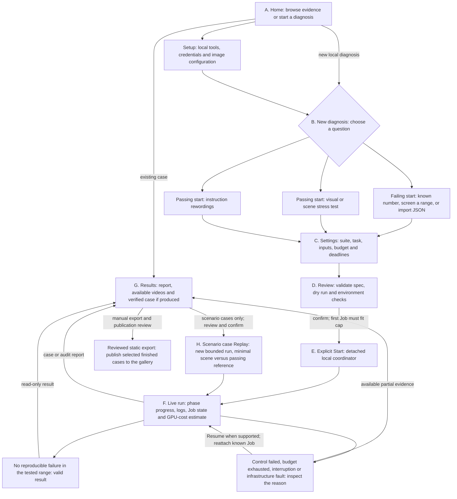
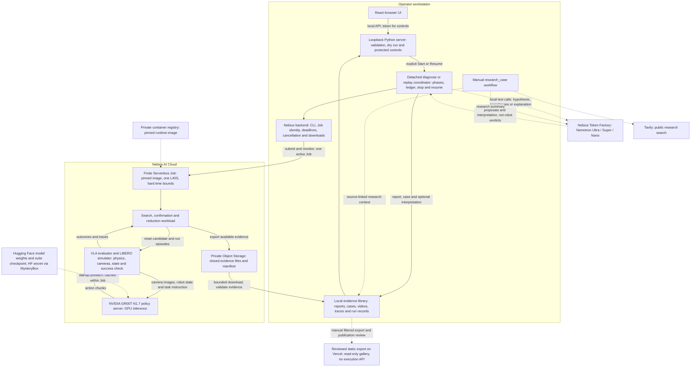

# Faultline architecture

> Generated, source-checked reference for the current system. This is the
> canonical architecture document, not a proposal to change runtime behaviour.
> See [current state](codex-handoff/STATE.md) for progress,
> [the runbook](codex-handoff/RUNBOOK.md) for commands, and
> [decisions](decisions/) for accepted design rationale.

For **the reduction algorithm** (gates, probe, ddmin, split, shrink, the
report's columns), read [how a scenario reduction works](how-reduction-works.md).
For **how to use the UI**, start with the [UI user runbook](ui-runbook.md):
saved-case walkthrough, goal-based recipes, result interpretation and recovery.
This document explains the system; it is not the first-use tutorial.

## Read this first

Faultline has **two product modes, implemented by three execution paths**:

```text
Mode 1 — Debug a failing start
  scenario: compare failing/passing scene states and reduce their differences

Mode 2 — Audit a policy from a passing start
  audit: search visual/scene disturbance strengths
  paraphrase: search instruction rewordings and reduce word edits
```

The New diagnosis UI currently renders those three execution paths as three
peer cards. Calling each a "mode" without saying which layer is meant creates
the confusion. In this document, **Mode 1/Mode 2 mean product intentions**;
`scenario`, `audit` and `paraphrase` mean the actual YAML/CLI execution paths.
This follows [ADR 0027](decisions/0027-m7-product-consolidation-and-access.md)
and [ADR 0032](decisions/0032-breadth-pack.md), not a newly chosen architecture.

### Vocabulary

| Term | Meaning here |
| --- | --- |
| Policy | The trained model controlling the robot, currently NVIDIA GR00T N1.7. |
| Suite / task / start | A collection of benchmark tasks / one robot goal and scene / one initial arrangement of that same task. |
| Episode | One attempt by the policy to complete the task from a specified start. |
| Perturbation family | A type of input change, such as blur, lighting or wording; not a different task or suite. |
| Run | One diagnosis or replay invocation, which can contain several cloud Jobs and many episodes. |
| Job | A finite GPU container executing a workload; not one Job per robot movement. |
| Case | A saved result/evidence identity. The library can also expose run-only findings; not every item is a reduced failure. |
| Reduce | Remove or shrink changes while checking the failure still repeats; not retrain/fix the robot policy. |
| Replay | Run fresh simulator episodes against a saved scenario regression case; not just play its video. |

## Product and evidence boundary

Faultline turns a simulated robot-policy failure into a small, repeatable,
replayable case within a fixed compute budget. The loop searches, confirms a
failure (at least four of five reruns while controls pass), reduces its
trigger, and stores the report, videos, spend ledger and case. Its contribution
is that integrated diagnostic loop, not a claim of universal coverage, causal
proof or formal verification. Reports must name the policy, LIBERO suite,
task, start, seed, perturbation family and tested range. See [ADR 0027](decisions/0027-m7-product-consolidation-and-access.md)
and the [experiment notes](experiments/).

The official name is Faultline and the canonical repository is
[`jephoton/faultline-robotics-debugger`](https://github.com/jephoton/faultline-robotics-debugger).
Keep the `robot_debug` package, schema/case IDs, environment variables,
historical artifact identities and local checkout folder unchanged. M3/HPC
scale-out is optional stretch work; preserve its measured replay-throughput
result without making further HPC work a product gate ([ADR 0019](decisions/0019-faultline-name-and-hpc-scope.md)).

## Mode 1 and Mode 2 in plain language

1. **Debug a failing start (scenario):** screen benchmark starts, select a
   known failing start, or import a start-state file. Find a nearby passing
   reference, confirm the failure, and delta-debug the differences down to
   shifts needed together. Nemotron 3 Ultra proposes an ordering and a
   hypothesis before reruns; only simulator results establish the observed
   outcome. The demonstrated case is LIBERO-10 task 0, start 14.
2. **Audit a passing policy start:** search a specified family for a small
   disturbance that causes a repeatable failure. Eight image families (blur,
   noise, darken, contrast, JPEG compression, colour cast, motion blur and
   dead pixels) and two simulator scene families (viewpoint and lighting)
   use the threshold search. The language mode uses Nemotron 3 Super to
   generate instruction paraphrases and reduces a failing wording by word
   edits. The earlier camera-occlusion work is a historical M4–M6 path, not
   an audit-family option. See [ADR 0032](decisions/0032-breadth-pack.md).

The New diagnosis page currently exposes **three peer choices**, rather than
the two product intentions above. This is the implemented UI, not three
unrelated products:

| Current UI choice | Question it answers | What changes during the test |
| --- | --- | --- |
| Find why a start fails (`scenario`) | Which differences from a passing scene are needed for this start to keep failing? | Object/entity start-state shifts; remove shifts, then try smaller shifts. |
| Stress-test a passing start (`audit`) | How much of a selected visual or scene disturbance can this policy tolerate? | A numeric severity, such as blur strength or a lighting setting. |
| Test rewordings (`paraphrase`) | Can different words for the same task break the policy? | The task instruction; generate alternatives, screen them, then remove word edits if a faithful failing wording exists. |

The first choice has three input paths: a known benchmark start number, a
range of starts to screen, or an imported start-state JSON file. Import means
a validated MuJoCo state for a supported LIBERO suite/task, **not an arbitrary
video, robot log or new robot**. The other two choices start from a nominal
task/start and look for weaknesses in different inputs. Wording needs discrete
word-edit search and text generation; visual/scene audit uses numeric severity
search. That is why they have separate execution paths today.

### Does rewording belong under stress-testing?

**Yes, as a product category.** A VLA policy consumes images, robot state and
language. Stress-testing asks whether it can still do the same task when an
input changes. Blurring a picture probes visual robustness; rephrasing the
instruction probes language robustness. Neither requires changing the task.

For an illustrative, unmeasured example, "put the soup in the basket" and
"place the soup inside the basket" ask for the same action. "Put the soup on
the table" changes the target and is not a valid same-task robustness test.
The current meaning check only guards some object/target words, so it cannot
prove that every retained rewording has identical meaning.

**No, not as just another numeric severity checkbox in today's engine.** Blur
has a strength that can be swept and bisected. Words have no corresponding
0-to-1 severity scale. Rewordings therefore need generation, a meaning guard,
screening, and reduction over word edits. They can share the product category,
budget/lifecycle/evidence infrastructure and repeatability discipline without
sharing exactly the same search algorithm. Currently visual/scene and wording
are separate runs; choosing one does not automatically execute the other.

**Proposed, not accepted or implemented:** group the interface by intention:
"Debug a failing start" versus "Stress-test a policy", with "Images and scene"
and "Instruction wording" as stress-test subchoices. Keep their separate
execution paths. Review this with Jethro before changing the form. The
existing three-card layout exposes implementation details and is a known
clarity issue, not a requirement that users understand three architectures.

The tested policy is NVIDIA GR00T N1.7, with a pinned checkpoint for each of
LIBERO Object, 10, Spatial and Goal. The evaluator uses the AllenAI VLA
evaluation harness, robosuite/MuJoCo and a GR00T model server on one Nebius
L40S GPU per Serverless Job. A local NVIDIA GPU backend is implemented but
has not been validated on hardware. A checkpoint override can target a
different policy, but compatibility remains the operator's responsibility.

## End-to-end user journey

Letters identify discussion points; solid arrows describe existing paths.
This is the local operator experience. The public gallery is only the final,
separately exported reading path, not a hosted control plane.



At **D**, dry run does not start a GPU or generate text. The form is backed by
the same YAML spec as the CLI; advanced YAML can override supported settings
that have no dedicated form field. Admission only requires the first Job to
fit, not the sum of every possible phase. At **E/F**, the coordinator reserves
each Job's bounded worst-case cost before submitting it, then settles its
estimate; insufficient remaining budget stops further Jobs.

At **F**, Stop requests cancellation and waits for the Job's disposition;
closing the browser or panel server does not stop the detached run. Resume
uses recorded phase/Job identities to reattach or continue, rather than
blindly submitting another paid copy. Recovery is not a guarantee that an
unreachable provider has stopped billing: the recorded reason and provider
state still matter. The top main-content Back button always returns to **A**;
the wizard's separate Back buttons select its previous step. Home navigation
does not cancel a running diagnosis.

At **G**, a run is not synonymous with a failure case. A passing screen can
finish with a run-only report; an audit may register a summary with no failing
threshold. Partial evidence is not automatically a confirmed or fully reduced
counterexample. At **H**, Replay is a new experiment, not video playback: it
reruns the reduced scene and reference, optionally against another checkpoint,
and reports still-reproduces, fixed or inconclusive.

### What each engine actually does

- **Scenario:** screen starts/find a passing reference, compare the failing
  state with nearby passing states, optionally ask Nemotron Ultra for a
  hypothesis and test ordering, then test subsets of entity shifts and smaller
  shifts. Keep only differences whose simulator reruns retain the required
  failure evidence. Imported states use the benchmark screen as a passing
  reference pool, not as proof that the imported state fails. A missing passing
  reference or failed confirmation blocks the corresponding claim. A stopped
  size search can still leave a useful verified case; it is not a global minimum.
- **Visual/scene audit:** check the nominal control, sweep the selected
  disturbance's severity, confirm an apparent failure, then refine the bracket
  between a non-reproducible and reproducible failure within configured limits.
  The lower bracket is not a promise that every rerun passes. Not finding a threshold is a
  useful outcome. A measured threshold is only for that family, task, state and
  tested range; severity need not imply globally monotonic policy behaviour.
- **Rewordings:** Nemotron Super generates alternatives; a conservative
  object/target-word check flags changed meanings (it is not a semantic proof).
  The GPU screen tests the original and alternatives. Reduction requires the
  original control to pass and a retained wording to fail at least four of five
  reruns; then remove word edits while retaining that evidence. Flagged texts
  can be screened but cannot become the reduced faithful-wording case.

Confirmation/control counts are engine-specific; do not describe every mode
as five nominal control episodes. Search, confirmation and reduction execute
in the Job workloads. The local coordinator chooses phases and continuation
Jobs; it does not send each robot action or reduction candidate from the browser.

## Full-system deployment and evidence flow

### Technologies and why they are here

| Component | Responsibility and reason for the boundary |
| --- | --- |
| React + TypeScript + Vite | Interactive control-panel pages and typed API access. Its built bundle ships inside the Python package, so operators need no Node toolchain just to use it. |
| Python local server | Serves the UI and existing evidence, validates specs, protects controls and launches the CLI. It does not host the robot GPU on the laptop. |
| Detached Python CLI coordinator | Owns recoverable phases, per-Job reservations, deadlines, downloads and reports. Detachment prevents closing the UI/server from killing a paid diagnosis. |
| Nebius CLI/backend | Uses the operator's cloud project to submit finite Jobs and record identities for recovery. This is not an open public run service billing the project author. |
| Serverless GPU container | Runs the pinned evaluation/model environments with bounded runtime. No VM must be left running between diagnoses. |
| AllenAI VLA harness + LIBERO + robosuite/MuJoCo | Adapts policy observations/actions, simulates robot physics and provides task success checks. Faultline builds diagnosis around these existing tools, not a new robotics simulator. |
| GR00T N1.7 | The VLA policy being tested: turns camera images, robot state and language into action chunks. |
| Private Object Storage | Transfers completed evidence off the ephemeral Job before downloading it locally. Live simulator/SQLite state is not treated as safely writable bucket storage. |
| Token Factory / Nemotron | Local text requests: Ultra for scenario hypotheses/explanations, Super for wording generation, Nano for research summaries. Model prose is not the simulator's verdict. |
| Tavily | Optional manual public-research lookup; gives related work, not evidence that a robot failed. |
| Static export + Vercel | A reviewed, read-only subset of results for visitors/judges, with no cloud-execution credentials or controls. |

The solid execution path below is the validated Serverless route. Dotted links are
supporting inputs, optional interpretation/research, or manual publication.
Job-to-simulator and simulator-to-policy arrows run **inside one container**,
not between multiple rented machines.



### Responsibilities and trust boundaries

- **GR00T is the robot policy.** It sees task language, scene/wrist images and
  robot state, and predicts actions. LIBERO supplies the task-success check.
  **Nemotron is not driving the arm or deciding whether an episode succeeded.**
- **The workstation is the control plane.** The UI is not required for a run
  to continue. The local coordinator handles orchestration and GPU-cost
  reservations; the Job owns the simulator/model processes and their cleanup.
  Current core diagnoses do not require the old M3 multi-worker benchmark or
  distributed multi-GPU scheduling. Different phases can use separate Jobs;
  it is not one new Job per simulator action or candidate.
- **Keys stay out of the browser and public gallery.** The browser receives a
  local session token, not provider credentials. Hugging Face model access is
  supplied to the Job through MysteryBox; Token Factory calls stay local.
  Model weights are fetched at startup, not baked into the runtime image.
- **Evidence precedes interpretation.** Available completed files are exported
  through private storage, downloaded and checked before reporting. Nemotron
  explanations refer to recorded evidence; failure to generate an explanation
  does not change an episode's measured outcome. Partial/infrastructure results
  must stay labelled as such.
- **Costs have separate scopes.** The diagnosis ledger/UI tracks estimated
  GPU/Job cost under its reservation model. Token Factory explicitly runs
  outside that GPU ledger; Tavily and other service/storage charges are not a
  consolidated all-services bill. Billing reconciliation remains necessary.
- **Local versus public are different product surfaces.** The local UI can
  launch an explicitly confirmed paid run; the public gallery cannot. New local
  evidence is not automatically published. A local NVIDIA backend exists but
  is not the hardware-validated path depicted here.

### Does the current UI cover the journey?

| Journey boundary | Current support | Limit to make clear during UI review |
| --- | --- | --- |
| A/B: choose intent/input | Three cards; scenario number/range/JSON subchoices | Two intentions are mixed with three engine types; regrouping is only proposed. Arbitrary video/log import is not supported. |
| C/D: configure and understand cost | Forms, editable YAML, validation, environment checks and dry-run Job estimates | No complete account-provisioning wizard. The displayed cap is not a consolidated Token Factory/Tavily/storage bill. |
| E/F: execute and recover | Confirmed Start, running page, logs, timeline, cost, Stop/Resume | Browser navigation is not Stop. Resume does not promise every failure is retryable or that provider state is reachable. |
| G: inspect findings | Mode-specific case/report pages, comparison evidence where available, no-failure outcomes | Not every run yields a confirmed failure case, video or explanation. Current audit/paraphrase cases have no generated explanation. |
| H: run regression check | Scenario Replay with a fresh plan/confirmation and optional checkpoint override | No audit/paraphrase Replay command yet; replay compatibility is not guaranteed for an arbitrary checkpoint. |
| Research/public sharing | Stored research context and a separate static gallery | Tavily research is a manual script demonstrated on historical occlusion cases, not an automatic New diagnosis stage. Export/publication are operator steps. |

The UI's "smallest" wording describes the reduction goal, not a proof of a
global minimum. Show the actual stop reason, tested bracket or local-minimality
scope when explaining results. These are current implementation boundaries,
not approval for additional features or publication.

### Source anchors for verifying the map

- UI choice labels and input branches:
  [`StepChoose.tsx`](../web/src/components/new/StepChoose.tsx).
- Dry-run/admission/confirmation:
  [`StepReview.tsx`](../web/src/components/new/StepReview.tsx);
  navigation: [`Shell.tsx`](../web/src/components/Shell.tsx).
- API protection and detached lifecycle:
  [`viewer/server.py`](../src/robot_debug/viewer/server.py),
  [`viewer/routes.py`](../src/robot_debug/viewer/routes.py),
  [`viewer/launcher.py`](../src/robot_debug/viewer/launcher.py).
- Phase logic, evidence, controls and outcomes:
  [`orchestrator.py`](../src/robot_debug/orchestrator.py), especially
  `_scenario`, `_scenario_import`, `_reduce_loop`, `_audit`, `_paraphrase`,
  `_explain` and `_replay`.
- Cloud lifecycle and in-container model/simulator wiring:
  [`backends/nebius.py`](../src/robot_debug/backends/nebius.py),
  [`job_entry.py`](../src/robot_debug/job_entry.py).
- Exact imported-state contract:
  [`scenario_import.py`](../src/robot_debug/scenario_import.py).
- Optional research and static publication:
  [`research_case.py`](../scripts/research_case.py),
  [`viewer/export.py`](../src/robot_debug/viewer/export.py),
  [gallery acceptance record](experiments/m7-public-gallery.md).

## Runtime map

- `faultline diagnose SPEC.yaml` is the local coordinator for both modes.
  `src/robot_debug/cli.py` and the diagnosis/orchestration modules validate
  the spec, reserve a bounded worst-case Job cost, drive search and reduction,
  store reports/cases, and manage stop/resume. The Nebius backend wraps the
  official CLI, submits finite Jobs, resubmits capacity failures within its
  bound, watches deadlines, downloads evidence from private Object Storage
  and cleans up temporary access. Local specs, ledgers, provider keys and
  optional LLM calls remain on the workstation. See [ADR 0031](decisions/0031-faultline-diagnose.md).
- `faultline replay` reruns a saved **scenario** case against its minimal
  scene and passing reference, optionally with another checkpoint. Audit and
  paraphrase cases do not yet have this replay command. `faultline cases`
  lists registered cases.
- `web/` contains the React/Vite control panel. Its committed build lives in
  `src/robot_debug/viewer/app/` and is served by the Python loopback server
  through `faultline ui`. It shows runs, cases, Setup, diagnosis form/dry run,
  live progress and safe Stop/Resume/Replay controls. The browser controls
  call the same CLI workflow and require a session token and same-origin
  checks. `faultline export` makes a separate static gallery of finished
  cases with no provider calls or controls. It is a filtered publication
  artifact, not a live copy of the local server ([ADR 0033](decisions/0033-control-panel-ui.md)).
  The [public gallery](https://faultline-robotics-debugger.vercel.app) is live;
  its [publication record](experiments/m7-public-gallery.md) defines the
  included evidence, verification and remaining limitations.
- Nemotron 3 Ultra writes pre-rerun scenario hypotheses and explanations of
  verified scenario and historical occlusion cases. Nemotron 3 Super writes
  paraphrases; Nemotron 3 Nano summarizes related research. Audit and
  paraphrase cases have no generated explanations yet. Model text is marked
  as interpretation and validated against recorded evidence, never used as
  the success oracle ([ADR 0030](decisions/0030-nemotron-model-per-task.md)).
- `scripts/research_case.py` is an optional, manual Tavily workflow used on
  historical occlusion cases only. Source-linked research is context, not
  evidence for a robot-policy result; it has not been run on the newer
  scenario, audit or paraphrase cases.

`configs/specs/` holds portable example specs. `artifacts/` holds ignored
local run data and private provider details; `demo/root/` holds one safe,
finished diagnosis viewable without cloud access. `docs/experiments/` records
evidence and claim limits; `FEEDBACK.md` records actual tool experience.

## Operating boundaries

Every paid run needs an approved per-run cap, fresh authentication, account,
balance/expiry, quota/capacity and price checks. Keep Nebius account/project
boundaries in run records and one owner for cloud lifecycle and spending. The
original US$75 overall credit envelope remains a planning ceiling until
Jethro changes it. Cost estimates based on container time and assumed
Serverless billing are not reconciled posted bills. Cloud architecture,
new model/simulator or perturbation choices, higher caps, public publication
and submission claims are Jethro's decisions. Never commit credentials,
private resource identifiers, secret-bearing logs or model weights. Original
project code remains under the MIT licence; external assets retain their own
terms (`NOTICE.md`).

## UI reference: what is actually exposed

This inventory describes the current source, not an unimplemented ideal UI.
Most pages show summaries of saved evidence; they do not expose every backend
parameter, event or internal search decision as a dedicated control.

### 1. Home and the shared workspace

- **Local Home (`/`):** running diagnoses, current step and spend when recorded;
  latest library item; New diagnosis; a Find/Confirm/Reduce/Replay explanation.
- **Sidebar:** runs in progress and saved library items grouped by kind;
  local links to Setup, Run your own (Guide) and All evidence. The product mark
  and top main-content Back button return home. The Back button is hidden at
  home and is separate from the wizard's previous-step buttons.
- **Shared controls:** light/dark appearance, mobile sidebar drawer, skip link
  and route focus behaviour. These presentation controls do not start compute.
- **Public Home:** exported cases grouped by kind and Guide; no New diagnosis,
  live-run list, Setup or All evidence controls. Shared visual styling does not
  mean it is connected to the local coordinator.

### 2. New diagnosis: choose, configure, review

**Step 1 — What to diagnose:** three peer cards with the exact names from the
earlier table. The first card expands the three scenario input choices. The
interface does **not** currently display a top-level Mode 1/Mode 2 grouping.

**Step 2 — Settings:**

| Scope | Dedicated form controls |
| --- | --- |
| Every path | Run name; one of four LIBERO suites; task and its benchmark instruction; US-dollar spend cap; hour limit; editable YAML. |
| Scenario: known start | Benchmark start number, 0–49. |
| Scenario: screen starts | Start range, such as `10-49`; screen confirmation count out of five. |
| Scenario: import | JSON start-state upload tied to the chosen suite/task. Browser checks syntax/size; backend checks the actual state contract. |
| Any scenario input | Optional checkbox to request Nemotron's hypothesis and explanation. |
| Visual/scene audit | Benchmark start plus image/scene family checkboxes: eight image families, viewpoint and lighting. |
| Rewordings | Benchmark start and number of Nemotron rewordings requested, 1–12. No visual-family selector. Token Factory is required. |

YAML edits take precedence over the form until discarded. Backend image/secret
settings are reused from a local spec template or set through YAML; the form
does not provision an account or build the image. Advanced parameters such as
seed, compatible checkpoint overrides, reference selection or search bounds
have no universal dedicated form controls. Use supported schema fields through
YAML, not imagined UI toggles. Changing the form after editing YAML does not
silently update that edited spec.

**Step 3 — Review:** run name/kind/suite/task, full YAML, planned Job deadlines,
per-Job worst-case cost, total potential worst case, spend cap and hour limit;
environment-check results and explicit Start. If all potential phases exceed
the cap but the first Job fits, the page warns rather than blocking the entire
run; later Jobs are admitted individually by the coordinator. Validation and
required sign-in/key/first-Job checks can block Start. Docker readiness is
shown but is not required merely to run a prebuilt image. A timed-out Start
response does not offer an immediate second Start that might pay twice.

The review does **not** show a full account balance/expiry, current GPU quota or
capacity, an all-services bill, or a provider-guaranteed final charge. It checks
key presence, not that every future model request will succeed. The spend-field
copy is broader than the actual GPU/Job ledger: separate Token Factory charges
are not included in it.

### 3. Live run (`/run/:run`)

The page polls recorded progress about every five seconds, exposing:

- status, current step, execution kind and estimated spend/cap;
- current cloud-Job phase, including capacity waits when recorded;
- spent versus reserved money and elapsed versus allowed time;
- phase timeline, skipped/completed steps and recent log lines;
- confirmed Stop when stoppable; Resume when the API marks it resumable;
- completion/result link, or the stop/error/no-case reason.

This is **phase-level observability**, not a live robot-camera stream, GPU
profiler, full distributed tracing console or editable mid-run scheduler.
Available videos are viewed from recorded results. Home/Back/closing the tab
does not cancel the run. Stop and Resume invoke the coordinator; they are not
merely changes to a UI status label. Resume can attach to an existing known
Job or continue pending work, but additional unfinished work may still cost
money. Copy such as "never pays twice" is not a promise that every retry is free.

### 4. Saved results (`/case/:id`)

**Shared header and sections:** fault code, verdict, result kind, suite/task,
instruction, creation date and a plain-language finding; stop reason when
present; case/run/checkpoint identifiers where recorded. "How it was made"
shows the timeline, Jobs, cost estimate and time. Report renders saved Markdown;
Files offers the listed downloadable artifacts. Empty states mean evidence
was absent, not automatically that the policy failed.

| Result kind | What the specialized view exposes |
| --- | --- |
| Scenario | Failing/imported start and passing reference; number of differences; entity/size-reduction status; retained entity/part/fraction/physical-size table; synchronized original/minimal/reference videos when present; Nemotron ranking versus measured necessary/enough-alone results; expandable reruns showing selected shifts, attempt outcomes and decisions. |
| Visual/scene audit | Start and nominal-control attempt counts; family severity ladders with failure counts, marked threshold when one exists; videos only when available. No new Replay or explanation generation control. |
| Rewordings | Original instruction and its control outcomes; each generated wording with attempt outcomes and meaning-check status; reduced failing wording and edit list when available. A passing screen has nothing to reduce. |
| Historical M4 occlusion | Original/reduced rectangles and its own reduction/episode-evidence view. Browsing this case does not make occlusion an option in the current numeric audit-family form. |

**"Nemotron's reading" is a saved interpretation panel, not a chatbot.** It
shows model attribution, a Review required marker, hypotheses, observations,
evidence IDs and limitations if a reading exists. It has no conversational
prompt box and does not call a model on page load. Scenario's pre-test guess
versus measurement is a separate section from this post-test explanation.
Audit/paraphrase explanations are not generated by the current pipeline.

**Research context** displays stored related-work text and source links when
present. It does not run Tavily from the UI or automatically research every new
case. Current demonstrated research belongs to historical occlusion cases.

The screens use "cause", "smallest" and "fails from" as short labels. Read
them with the report's actual tested range, stop reason, completeness and
minimality scope. In particular, no threshold is not necessarily a completed
test through severity 1, and a reduced wording/scene is not a globally minimal
or formally proven cause.

### 5. Replay, Setup, Guide and All evidence

- **Replay:** scenario cases with replay inputs only. Shows prior replays;
  local controls let the operator choose expected result, cap/time limit and
  optional compatible checkpoint ID plus pinned revision. Dry run and confirm
  precede a new Job testing the minimal scene and passing reference five times
  each. Audit/paraphrase Replay is not supported. The public gallery may show
  stored replay history but cannot launch one.
- **Setup (`/setup`):** read-only checks for Nebius sign-in, Docker, Token
  Factory key presence and backend settings in a local spec. Shows Ready/Needs
  attention, repair guidance, Check again and guide links. It is not a full
  cloud-resource provisioning, billing or Hugging Face-access validation wizard.
- **Run your own (`/guide`):** static setup/usage instructions in either local
  or public mode. It describes commands; it does not execute them for a visitor.
- **All evidence (`/evidence`):** local episode catalog: episode/run, task and
  instruction, outcome/failure detail, steps/duration/date, optional video;
  outcome filter, text search and Show more in batches of 100. It is raw
  evidence, not another diagnosis engine. Perturbation parameters and trace
  URLs exist in the data contract but are not rendered as dedicated columns or
  trace-inspection tools on this page.

### UI assessment and proposed clarification

The UI exposes the main operator loop: **configure → review → launch → monitor
→ inspect → replay a scenario**. It is substantially more than a video viewer,
but not every engine has the same import, explanation or Replay capabilities.

Three different questions remain distinct:

1. **Is wording an audit?** Yes, by product intent; it probes the language input.
2. **Should it share the visual-audit algorithm?** No; retain the specialized
   generation/meaning-check/word-edit path.
3. **Does the UI convey that hierarchy clearly?** Not yet; it presents the
   three paths as peers without explaining the two intentions.

Options for that last point: keep three cards and add clearer grouping text
(least change); use two intent cards with visual/scene versus wording as
stress-test subchoices (**recommended**, matches the accepted product story);
or combine all families into one run selector (larger orchestration/cost change,
not needed just to clarify navigation). No option is implemented by this
documentation work. Likewise, the known over-broad budget/causality and
incomplete-audit labels are recorded review points, not silently fixed here.

### UI source anchors

- Routes, local/public rendering and shared navigation:
  [`App.tsx`](../web/src/App.tsx),
  [`HomePage.tsx`](../web/src/pages/HomePage.tsx),
  [`Sidebar.tsx`](../web/src/components/Sidebar.tsx).
- Wizard and spec generation:
  [`NewDiagnosisPage.tsx`](../web/src/pages/NewDiagnosisPage.tsx),
  [`StepSettings.tsx`](../web/src/components/new/StepSettings.tsx),
  [`specYaml.ts`](../web/src/lib/specYaml.ts),
  [`Review.tsx`](../web/src/components/new/Review.tsx).
- Live observations and controls:
  [`RunPage.tsx`](../web/src/pages/RunPage.tsx),
  [`RunParts.tsx`](../web/src/components/run/RunParts.tsx).
- Saved evidence and optional interpretation:
  [`CasePage.tsx`](../web/src/pages/CasePage.tsx),
  [`case components`](../web/src/components/case/).
- Ancillary pages: [`SetupPage.tsx`](../web/src/pages/SetupPage.tsx),
  [`GuidePage.tsx`](../web/src/pages/GuidePage.tsx),
  [`EvidencePage.tsx`](../web/src/pages/EvidencePage.tsx).
