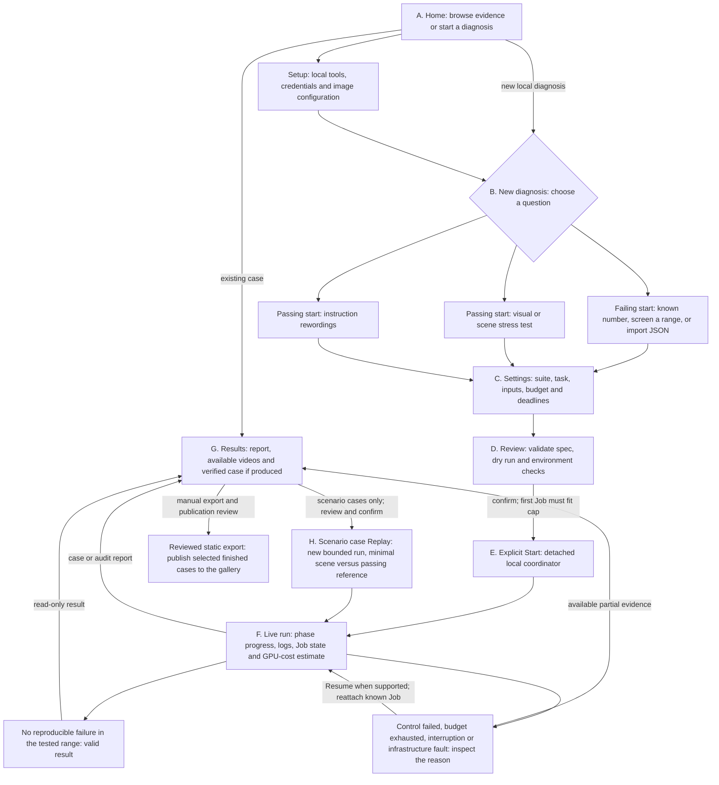
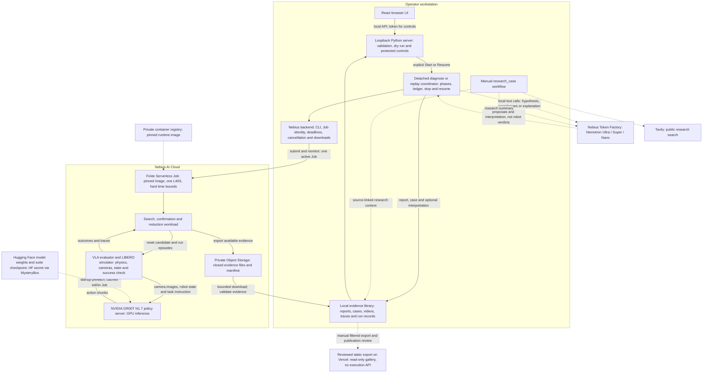

# Faultline project handoff

> Generated architecture summary. Read `STATE.md` for the current checkpoint,
> `RUNBOOK.md` for operations and `docs/decisions/` for accepted decisions.

## Product and evidence boundary

Faultline turns a simulated robot-policy failure into a small, repeatable,
replayable case within a fixed compute budget. The loop searches, confirms a
failure (at least four of five reruns while controls pass), reduces its
trigger, and stores the report, videos, spend ledger and case. Its contribution
is that integrated diagnostic loop, not a claim of universal coverage, causal
proof or formal verification. Reports must name the policy, LIBERO suite,
task, start, seed, perturbation family and tested range. See [ADR 0027](../decisions/0027-m7-product-consolidation-and-access.md)
and the [experiment notes](../experiments/).

The official name is Faultline and the canonical repository is
[`jephoton/faultline-robotics-debugger`](https://github.com/jephoton/faultline-robotics-debugger).
Keep the `robot_debug` package, schema/case IDs, environment variables,
historical artifact identities and local checkout folder unchanged. M3/HPC
scale-out is optional stretch work; preserve its measured replay-throughput
result without making further HPC work a product gate ([ADR 0019](../decisions/0019-faultline-name-and-hpc-scope.md)).

## Two user intentions, three execution modes

1. **Debug a failing start (scenario):** screen benchmark starts, select a
   known failing start, or import a start-state file. Find a nearby passing
   reference, confirm the failure, and delta-debug the differences down to
   shifts needed together. Nemotron 3 Ultra proposes an ordering and a
   hypothesis before reruns; only simulator results establish the observed
   outcome. The demonstrated case is LIBERO-10 task 0, start 14.
2. **Audit a passing policy start:** search a specified family for a small
   disturbance that causes a repeatable failure. Eight image families (blur,
   noise, darken, contrast, JPEG compression, colour cast, motion blur and
   dead pixels) and two simulator scene families (viewpoint and lighting)
   use the threshold search. The language mode uses Nemotron 3 Super to
   generate instruction paraphrases and reduces a failing wording by word
   edits. The earlier camera-occlusion work is a historical M4–M6 path, not
   an audit-family option. See [ADR 0032](../decisions/0032-breadth-pack.md).

The New diagnosis page currently exposes **three peer choices**, rather than
the two product intentions above. This is the implemented UI, not three
unrelated products:

| Current UI choice | Question it answers | What changes during the test |
| --- | --- | --- |
| Find why a start fails (`scenario`) | Which differences from a passing scene are needed for this start to keep failing? | Object/entity start-state shifts; remove shifts, then try smaller shifts. |
| Stress-test a passing start (`audit`) | How much of a selected visual or scene disturbance can this policy tolerate? | A numeric severity, such as blur strength or a lighting setting. |
| Test rewordings (`paraphrase`) | Can different words for the same task break the policy? | The task instruction; generate alternatives, screen them, then remove word edits if a faithful failing wording exists. |

The first choice has three input paths: a known benchmark start number, a
range of starts to screen, or an imported start-state JSON file. Import means
a validated MuJoCo state for a supported LIBERO suite/task, **not an arbitrary
video, robot log or new robot**. The other two choices start from a nominal
task/start and look for weaknesses in different inputs. Wording needs discrete
word-edit search and text generation; visual/scene audit uses numeric severity
search. That is why they have separate execution modes today.

**Proposed, not accepted or implemented:** group the interface by intention:
"Debug a failing start" versus "Audit a policy", with visual/scene and wording
as audit subchoices. Review this with Jethro before changing the form. The
existing three-card layout exposes implementation details and is a known
clarity issue, not a requirement that users understand three architectures.

The tested policy is NVIDIA GR00T N1.7, with a pinned checkpoint for each of
LIBERO Object, 10, Spatial and Goal. The evaluator uses the AllenAI VLA
evaluation harness, robosuite/MuJoCo and a GR00T model server on one Nebius
L40S GPU per Serverless Job. A local NVIDIA GPU backend is implemented but
has not been validated on hardware. A checkpoint override can target a
different policy, but compatibility remains the operator's responsibility.

## End-to-end user journey

Letters identify discussion points; solid arrows describe existing paths.
This is the local operator experience. The public gallery is only the final,
separately exported reading path, not a hosted control plane.

At **D**, dry run does not start a GPU or generate text. The form is backed by
the same YAML spec as the CLI; advanced YAML can override supported settings
that have no dedicated form field. Admission only requires the first Job to
fit, not the sum of every possible phase. At **E/F**, the coordinator reserves
each Job's bounded worst-case cost before submitting it, then settles its
estimate; insufficient remaining budget stops further Jobs.

At **F**, Stop requests cancellation and waits for the Job's disposition;
closing the browser or panel server does not stop the detached run. Resume
uses recorded phase/Job identities to reattach or continue, rather than
blindly submitting another paid copy. Recovery is not a guarantee that an
unreachable provider has stopped billing: the recorded reason and provider
state still matter. The top main-content Back button always returns to **A**;
the wizard's separate Back buttons select its previous step. Home navigation
does not cancel a running diagnosis.

At **G**, a run is not synonymous with a failure case. A passing screen can
finish with a run-only report; an audit may register a summary with no failing
threshold. Partial evidence is not automatically a confirmed or fully reduced
counterexample. At **H**, Replay is a new experiment, not video playback: it
reruns the reduced scene and reference, optionally against another checkpoint,
and reports still-reproduces, fixed or inconclusive.

### What each engine actually does

- **Scenario:** screen starts/find a passing reference, compare the failing
  state with nearby passing states, optionally ask Nemotron Ultra for a
  hypothesis and test ordering, then test subsets of entity shifts and smaller
  shifts. Keep only differences whose simulator reruns retain the required
  failure evidence. Imported states use the benchmark screen as a passing
  reference pool, not as proof that the imported state fails. A missing passing
  reference or failed confirmation blocks the corresponding claim. A stopped
  size search can still leave a useful verified case; it is not a global minimum.
- **Visual/scene audit:** check the nominal control, sweep the selected
  disturbance's severity, confirm an apparent failure, then refine the bracket
  between a non-reproducible and reproducible failure within configured limits.
  The lower bracket is not a promise that every rerun passes. Not finding a threshold is a
  useful outcome. A measured threshold is only for that family, task, state and
  tested range; severity need not imply globally monotonic policy behaviour.
- **Rewordings:** Nemotron Super generates alternatives; a conservative
  object/target-word check flags changed meanings (it is not a semantic proof).
  The GPU screen tests the original and alternatives. Reduction requires the
  original control to pass and a retained wording to fail at least four of five
  reruns; then remove word edits while retaining that evidence. Flagged texts
  can be screened but cannot become the reduced faithful-wording case.

Confirmation/control counts are engine-specific; do not describe every mode
as five nominal control episodes. Search, confirmation and reduction execute
in the Job workloads. The local coordinator chooses phases and continuation
Jobs; it does not send each robot action or reduction candidate from the browser.

## Full-system deployment and evidence flow

The solid execution path is the validated Serverless route. Dotted links are
supporting inputs, optional interpretation/research, or manual publication.
Job-to-simulator and simulator-to-policy arrows run **inside one container**,
not between multiple rented machines.

### Responsibilities and trust boundaries

- **GR00T is the robot policy.** It sees task language, scene/wrist images and
  robot state, and predicts actions. LIBERO supplies the task-success check.
  **Nemotron is not driving the arm or deciding whether an episode succeeded.**
- **The workstation is the control plane.** The UI is not required for a run
  to continue. The local coordinator handles orchestration and GPU-cost
  reservations; the Job owns the simulator/model processes and their cleanup.
  Current core diagnoses do not require the old M3 multi-worker benchmark or
  distributed multi-GPU scheduling. Different phases can use separate Jobs;
  it is not one new Job per simulator action or candidate.
- **Keys stay out of the browser and public gallery.** The browser receives a
  local session token, not provider credentials. Hugging Face model access is
  supplied to the Job through MysteryBox; Token Factory calls stay local.
  Model weights are fetched at startup, not baked into the runtime image.
- **Evidence precedes interpretation.** Available completed files are exported
  through private storage, downloaded and checked before reporting. Nemotron
  explanations refer to recorded evidence; failure to generate an explanation
  does not change an episode's measured outcome. Partial/infrastructure results
  must stay labelled as such.
- **Costs have separate scopes.** The diagnosis ledger/UI tracks estimated
  GPU/Job cost under its reservation model. Token Factory explicitly runs
  outside that GPU ledger; Tavily and other service/storage charges are not a
  consolidated all-services bill. Billing reconciliation remains necessary.
- **Local versus public are different product surfaces.** The local UI can
  launch an explicitly confirmed paid run; the public gallery cannot. New local
  evidence is not automatically published. A local NVIDIA backend exists but
  is not the hardware-validated path depicted here.

### Does the current UI cover the journey?

| Journey boundary | Current support | Limit to make clear during UI review |
| --- | --- | --- |
| A/B: choose intent/input | Three cards; scenario number/range/JSON subchoices | Two intentions are mixed with three engine types; regrouping is only proposed. Arbitrary video/log import is not supported. |
| C/D: configure and understand cost | Forms, editable YAML, validation, environment checks and dry-run Job estimates | No complete account-provisioning wizard. The displayed cap is not a consolidated Token Factory/Tavily/storage bill. |
| E/F: execute and recover | Confirmed Start, running page, logs, timeline, cost, Stop/Resume | Browser navigation is not Stop. Resume does not promise every failure is retryable or that provider state is reachable. |
| G: inspect findings | Mode-specific case/report pages, comparison evidence where available, no-failure outcomes | Not every run yields a confirmed failure case, video or explanation. Current audit/paraphrase cases have no generated explanation. |
| H: run regression check | Scenario Replay with a fresh plan/confirmation and optional checkpoint override | No audit/paraphrase Replay command yet; replay compatibility is not guaranteed for an arbitrary checkpoint. |
| Research/public sharing | Stored research context and a separate static gallery | Tavily research is a manual script demonstrated on historical occlusion cases, not an automatic New diagnosis stage. Export/publication are operator steps. |

The UI's "smallest" wording describes the reduction goal, not a proof of a
global minimum. Show the actual stop reason, tested bracket or local-minimality
scope when explaining results. These are current implementation boundaries,
not approval for additional features or publication.

### Source anchors for verifying the map

- UI choice labels and input branches:
  [`StepChoose.tsx`](../../web/src/components/new/StepChoose.tsx).
- Dry-run/admission/confirmation:
  [`StepReview.tsx`](../../web/src/components/new/StepReview.tsx);
  navigation: [`Shell.tsx`](../../web/src/components/Shell.tsx).
- API protection and detached lifecycle:
  [`viewer/server.py`](../../src/robot_debug/viewer/server.py),
  [`viewer/routes.py`](../../src/robot_debug/viewer/routes.py),
  [`viewer/launcher.py`](../../src/robot_debug/viewer/launcher.py).
- Phase logic, evidence, controls and outcomes:
  [`orchestrator.py`](../../src/robot_debug/orchestrator.py), especially
  `_scenario`, `_scenario_import`, `_reduce_loop`, `_audit`, `_paraphrase`,
  `_explain` and `_replay`.
- Cloud lifecycle and in-container model/simulator wiring:
  [`backends/nebius.py`](../../src/robot_debug/backends/nebius.py),
  [`job_entry.py`](../../src/robot_debug/job_entry.py).
- Exact imported-state contract:
  [`scenario_import.py`](../../src/robot_debug/scenario_import.py).
- Optional research and static publication:
  [`research_case.py`](../../scripts/research_case.py),
  [`viewer/export.py`](../../src/robot_debug/viewer/export.py),
  [gallery acceptance record](../experiments/m7-public-gallery.md).

## Runtime map

- `faultline diagnose SPEC.yaml` is the local coordinator for both modes.
  `src/robot_debug/cli.py` and the diagnosis/orchestration modules validate
  the spec, reserve a bounded worst-case Job cost, drive search and reduction,
  store reports/cases, and manage stop/resume. The Nebius backend wraps the
  official CLI, submits finite Jobs, resubmits capacity failures within its
  bound, watches deadlines, downloads evidence from private Object Storage
  and cleans up temporary access. Local specs, ledgers, provider keys and
  optional LLM calls remain on the workstation. See [ADR 0031](../decisions/0031-faultline-diagnose.md).
- `faultline replay` reruns a saved **scenario** case against its minimal
  scene and passing reference, optionally with another checkpoint. Audit and
  paraphrase cases do not yet have this replay command. `faultline cases`
  lists registered cases.
- `web/` contains the React/Vite control panel. Its committed build lives in
  `src/robot_debug/viewer/app/` and is served by the Python loopback server
  through `faultline ui`. It shows runs, cases, Setup, diagnosis form/dry run,
  live progress and safe Stop/Resume/Replay controls. The browser controls
  call the same CLI workflow and require a session token and same-origin
  checks. `faultline export` makes a separate static gallery of finished
  cases with no provider calls or controls. It is a filtered publication
  artifact, not a live copy of the local server ([ADR 0033](../decisions/0033-control-panel-ui.md)).
  The [public gallery](https://faultline-robotics-debugger.vercel.app) is live;
  its [publication record](../experiments/m7-public-gallery.md) defines the
  included evidence, verification and remaining limitations.
- Nemotron 3 Ultra writes pre-rerun scenario hypotheses and explanations of
  verified scenario and historical occlusion cases. Nemotron 3 Super writes
  paraphrases; Nemotron 3 Nano summarizes related research. Audit and
  paraphrase cases have no generated explanations yet. Model text is marked
  as interpretation and validated against recorded evidence, never used as
  the success oracle ([ADR 0030](../decisions/0030-nemotron-model-per-task.md)).
- `scripts/research_case.py` is an optional, manual Tavily workflow used on
  historical occlusion cases only. Source-linked research is context, not
  evidence for a robot-policy result; it has not been run on the newer
  scenario, audit or paraphrase cases.

`configs/specs/` holds portable example specs. `artifacts/` holds ignored
local run data and private provider details; `demo/root/` holds one safe,
finished diagnosis viewable without cloud access. `docs/experiments/` records
evidence and claim limits; `FEEDBACK.md` records actual tool experience.

## Operating boundaries

Every paid run needs an approved per-run cap, fresh authentication, account,
balance/expiry, quota/capacity and price checks. Keep Nebius account/project
boundaries in run records and one owner for cloud lifecycle and spending. The
original US$75 overall credit envelope remains a planning ceiling until
Jethro changes it. Cost estimates based on container time and assumed
Serverless billing are not reconciled posted bills. Cloud architecture,
new model/simulator or perturbation choices, higher caps, public publication
and submission claims are Jethro's decisions. Never commit credentials,
private resource identifiers, secret-bearing logs or model weights. Original
project code remains under the MIT licence; external assets retain their own
terms (`NOTICE.md`).
